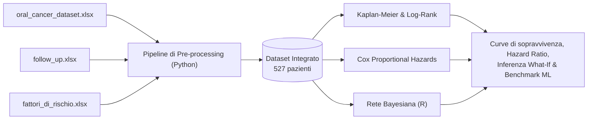

# SurvivalProbabilisticOSCC

[English](README.md) · **Italiano**

Metodologie probabilistiche classiche e bayesiane per l'analisi di sopravvivenza nel carcinoma del cavo orale: modelli statistici e grafici interpretabili a confronto con architetture di Machine Learning.

Questa repository contiene il codice della tesi di laurea triennale *Metodologie probabilistiche classiche e bayesiane per l'analisi di sopravvivenza in pazienti affetti da carcinoma del cavo orale*, Corso di Laurea in Informatica, Università degli Studi di Salerno (Laboratorio CAIS), anno accademico 2024/2025.

## Cosa fa

* Consolida oltre 2.000 record clinici longitudinali provenienti da tre tabelle grezze TCGA-HNSC in un'unica coorte di 527 pazienti affetti da carcinoma squamocellulare del cavo orale (OSCC), strutturata con una singola riga per paziente.

* Stima le funzioni di sopravvivenza non parametriche tramite curve di Kaplan-Meier ed esegue uno screening univariato tra sottogruppi mediante test log-rank.

* Addestra un modello di regressione multivariata a rischi proporzionali di Cox (CPH) per quantificare gli Hazard Ratio, validato tramite Likelihood Ratio Test, diagnostica dei residui di Schoenfeld e 500 ricampionamenti bootstrap.

* Apprende una Rete Bayesiana (BN) discreta con vincoli strutturali clinici per eseguire inferenza probabilistica condizionale e analisi di scenario what-if anche in presenza di evidenza parziale.

* Confronta i modelli probabilistici con tre modelli di Machine Learning (XGBoost, Random Survival Forest e DeepSurv) sullo stesso dataset.



## Risultati

### Modello a Rischi Proporzionali di Cox

Regressione multivariata stimata sui principali predittori clinici selezionati tramite screening univariato log-rank (`Hist_RECURRENCE`, `Intent_CURE` e coinvolgimento linfonodale `N_grp`):

| Covariata | Hazard Ratio (HR) | IC 95% (Low) | IC 95% (High) | p-value | 
| ----- | ----- | ----- | ----- | ----- | 
| `Hist_RECURRENCE` | **2.864** | 2.109 | 3.888 | 1.53e-11 | 
| `Intent_CURE` | **0.363** | 0.271 | 0.487 | 1.26e-11 | 
| `N_grp_N1` | 0.990 | 0.485 | 1.222 | 2.68e-01 | 
| `N_grp_N2+` | **1.852** | 1.401 | 2.449 | 1.50e-05 | 

* Significatività globale del modello confermata tramite Likelihood Ratio Test ($\chi^2(4) = 106.27, p < 0.005$).

* La validazione interna mediante $B = 500$ ricampionamenti bootstrap restituisce un C-index apparente pari a **0.699** e un C-index corretto per ottimismo pari a **0.693** (ottimismo medio: 0.006).

### Rete Bayesiana e Inferenze What-If

In 10-fold cross-validation, la Rete Bayesiana discreta raggiunge un'**AUC di 0.706** e un **Brier score di 0.214**. Definendo un profilo paziente di riferimento data-driven (`age_grp >= 60`, `stage = IV`, `surgery = No`, `Hist_METASTASIS = No`, `Hist_RECURRENCE = No`, $n = 91$), le interrogazioni probabilistiche condizionali valutano l'impatto della variazione di singoli fattori clinici:

| Scenario Clinico | P(Dead \| Evidenza) | Delta vs. Baseline | 
| ----- | ----- | ----- | 
| Profilo baseline | 0.505 | — | 
| `surgery = Yes` | **0.087** | **-0.419** | 
| `Hist_RECURRENCE = Yes` | **0.922** | **+0.417** | 
| `Hist_METASTASIS = Yes` | **0.641** | **+0.135** | 

### Confronto con i Modelli di Machine Learning

Confronto delle prestazioni tra i modelli probabilistici classici, la Rete Bayesiana e tre architetture di Machine Learning addestrate sulla stessa coorte:

| Modello | C-index ↑ | IBS / Brier Score ↓ | Mean AUC ↑ | 
| ----- | ----- | ----- | ----- | 
| XGBoost | **0.7248** | 0.1891 | **0.7339** | 
| Random Survival Forest | 0.7164 | 0.1887 | 0.6997 | 
| DeepSurv | 0.7075 | 0.2039 | 0.7064 | 
| **Cox PH (Questo studio)** | 0.6989 | **0.1876** | 0.7111 | 
| **Rete Bayesiana (Questo studio)** | 0.6723 | 0.2136 | 0.7060 | 

La tabella di confronto va letta tenendo conto di due osservazioni metodologiche:

* Sebbene i modelli ensemble di ML raggiungano una capacità discriminante superiore (C-index), il modello classico di Cox ottiene il miglior Integrated Brier Score (**0.1876**) e una Mean AUC competitiva (**0.7111**) garantendo interpretabilità intrinseca.

* La Rete Bayesiana modella un endpoint binario di mortalità anziché una funzione di rischio continua nel tempo; il relativo C-index (**0.6723**) è derivato utilizzando le probabilità a posteriori di decesso come risk score.

### Curve di Sopravvivenza e Stratificazione per Sottogruppi

Curva di sopravvivenza globale di Kaplan-Meier con bande di confidenza al 95% (a sinistra) e curve di sopravvivenza stratificate per intento terapeutico curativo, stadio linfonodale e recidiva (a destra).

<p align="center">
  
  
</p>

### Struttura della Rete Bayesiana

Grafo Aciclico Diretto (DAG) appreso tramite algoritmo ibrido Max-Min Hill-Climbing con punteggio BIC e vincoli clinici a priori. Il Markov blanket di `death` coincide con `{age_grp, stage, surgery, Hist_METASTASIS, Hist_RECURRENCE}`.

<p align="center">
  
</p>

## Scelte Metodologiche e Pre-processing

Per garantire coerenza clinica e prevenire artefatti statistici su una coorte di dimensioni contenute ($n = 527$), la pipeline applica regole rigorose di preparazione e modellazione:

1. **Consolidamento a livello paziente.** I record longitudinali di follow-up vengono ricondotti all'ultimo contatto disponibile (`days_to_follow_up`), i record relativi alle terapie vengono trasformati in indicatori binari e le tabelle dei fattori di rischio vengono deduplicate prima dell'integrazione tramite `case_id`.

2. **Gestione dei dati mancanti e della sparsità.** Le feature con oltre il 70% di valori mancanti (`treatment_outcome` e alcune variabili sul consumo di alcol) e le colonne a varianza nulla vengono rimosse. La stadiazione TNM patologica viene integrata con quella clinica, i livelli rari vengono accorpati in macro-categorie clinicamente coerenti e le variabili categoriali con elevata missingness (`laterality`, 34,0%) mantengono una categoria esplicita `Missing`.

3. **Verifica dei rischi proporzionali.** Le assunzioni della regressione di Cox sono verificate tramite residui scalati di Schoenfeld affiancati da Likelihood Ratio Test su modelli annidati.

4. **Apprendimento strutturale guidato dalla conoscenza.** L'apprendimento del grafo della Rete Bayesiana integra blacklist temporali (che impediscono archi dall'outcome verso le variabili anagrafiche e basali) e whitelist cliniche, adottando prior di Dirichlet nella stima dei parametri per gestire celle a bassa frequenza.

## Modelli e Workflow

| Componente | Ambiente / Librerie | Dettagli Metodologici | 
| ----- | ----- | ----- | 
| Data Preparation & KM | Python (`pandas`, `scikit-learn`, `scikit-survival`) | Deduplicazione record, ricostruzione TNM, stima di Kaplan-Meier con IC 95%, screening univariato log-rank | 
| Cox Proportional Hazards | Python (`scikit-survival`, `scikit-learn`) | Ottimizzazione della partial likelihood, one-hot encoding con categorie di riferimento, diagnostica residui di Schoenfeld, validazione bootstrap su 500 repliche | 
| Rete Bayesiana | R (`bnlearn`, `gRain`) | Max-Min Hill-Climbing ibrido (score BIC), stabilità strutturale tramite bootstrap non parametrico, test di indipendenza condizionata Monte Carlo, 10-fold CV (AUC e Brier score) | 

## Struttura della repository

```
Survival_Analysis/
├── data/
│   ├── oral_cancer_dataset.xlsx         record clinici, di stadiazione e trattamento
│   ├── follow_up.xlsx                   record longitudinali di follow-up
│   └── fattori_di_rischio.xlsx          record su esposizione a tabacco e alcol
├── preprocessing/                       script Python per pulizia, merge e feature engineering
├── survival_models/                     script per Kaplan-Meier, Log-Rank e regressione di Cox
├── bayesian_network/                    script R per apprendimento struttura BN, inferenza e CV
├── results/                             figure generate, curve di sopravvivenza e tabelle riassuntive
├── README.md                            versione inglese
└── README.it.md                         questo file
```

## Avvio rapido

```bash
git clone https://github.com/flaviodesimone03/Survival_Analysis.git
cd ProgettoTesiFLavio_de_Simone
```

1. **Ambiente Python (Pre-processing, Kaplan-Meier, Cox PH):**

   ```bash
   python -m venv .venv
   source .venv/bin/activate        # Windows: .venv\Scripts\activate
   pip install pandas numpy scikit-learn scikit-survival openpyxl matplotlib
   ```

2. **Ambiente R (Rete Bayesiana e Inferenza Esatta):**

   ```r
   install.packages(c("bnlearn", "gRain"))
   ```

## Limiti noti

* **Rappresentazione al baseline di eventi longitudinali.** Indicatori clinici come `Hist_RECURRENCE` e `Hist_METASTASIS` sono codificati come variabili binarie al baseline; in uno scenario diagnostico puro al Tempo 0, la recidiva è un evento successivo alla diagnosi e richiederebbe una modellazione come covariata tempo-dipendente.

* **Valutazione su singola coorte.** Tutti i modelli sono validati internamente (bootstrap a 500 iterazioni per il modello di Cox; 10-fold cross-validation per la Rete Bayesiana) senza validazione esterna multi-istituzionale.

* **Numerosità ridotta nei sottogruppi degli stadi precoci.** Le stime incrementali di probabilità per le metastasi negli stadi tumorali iniziali (Stadi I–II e III) si basano su un numero limitato di osservazioni ($n = 2$ e $n = 5$, rispettivamente) e vanno interpretate con cautela.

## Dati

Il dataset (`OralCancerDataset`) deriva dal progetto **TCGA-HNSC** (*The Cancer Genome Atlas – Head and Neck Squamous Cell Carcinoma*), distribuito dal National Cancer Institute statunitense tramite il [GDC Data Portal](https://portal.gdc.cancer.gov/projects/TCGA-HNSC).

> I risultati qui mostrati sono basati in tutto o in parte su dati generati dal TCGA Research Network: <https://www.cancer.gov/tcga>.

## Tecnologie utilizzate

Python · R · pandas · scikit-learn · scikit-survival · bnlearn · gRain · Matplotlib
