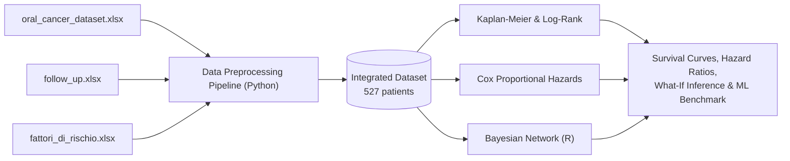

# SurvivalProbabilisticOSCC

**English** · [Italiano](README.it.md)


Classical and Bayesian probabilistic methodologies for survival analysis in oral cavity carcinoma: interpretable statistical and graphical models compared against Machine Learning architectures.

This repository contains the code of the bachelor's thesis *Metodologie probabilistiche classiche e bayesiane per l'analisi di sopravvivenza in pazienti affetti da carcinoma del cavo orale* ("Classical and Bayesian Probabilistic Methodologies for Survival Analysis in Patients with Oral Cavity Carcinoma"), Computer Science, University of Salerno (CAIS Laboratory), academic year 2024/2025.

## What it does

- Consolidates over 2,000 longitudinal clinical records from three raw TCGA-HNSC tables into a single one-row-per-patient cohort of 527 Oral Squamous Cell Carcinoma (OSCC) patients.
- Estimates non-parametric survival functions via Kaplan-Meier curves and performs univariate subgroup screening with log-rank tests.
- Fits a multivariate Cox Proportional Hazards (CPH) regression model to quantify Hazard Ratios, validated via Likelihood Ratio Tests, Schoenfeld residuals, and 500 bootstrap resamples.
- Learns a discrete Bayesian Network (BN) with structural clinical constraints to perform conditional probability inference and what-if scenario analyses under partial evidence.
- Benchmarks the probabilistic models against three Machine Learning models (XGBoost, Random Survival Forest, and DeepSurv) on the same dataset.



## Results

### Cox Proportional Hazards Model

Multivariate regression fitted on the primary clinical predictors selected via univariate log-rank screening (`Hist_RECURRENCE`, `Intent_CURE`, and nodal staging `N_grp`):

| Covariate | Hazard Ratio (HR) | 95% CI (Low) | 95% CI (High) | p-value |
|---|---|---|---|---|
| `Hist_RECURRENCE` | **2.864** | 2.109 | 3.888 | 1.53e-11 |
| `Intent_CURE` | **0.363** | 0.271 | 0.487 | 1.26e-11 |
| `N_grp_N1` | 0.990 | 0.485 | 1.222 | 2.68e-01 |
| `N_grp_N2+` | **1.852** | 1.401 | 2.449 | 1.50e-05 |

- Global model significance confirmed via Likelihood Ratio Test ($\chi^2(4) = 106.27, p < 0.005$).
- Internal validation via $B = 500$ bootstrap resamples yields an apparent C-index of **0.699** and an optimism-corrected C-index of **0.693** (mean optimism: 0.006).

### Bayesian Network & What-If Inference

In 10-fold cross-validation, the discrete Bayesian Network achieves an **AUC of 0.706** and a **Brier score of 0.214**. Using a data-driven baseline patient profile (`age_grp >= 60`, `stage = IV`, `surgery = No`, `Hist_METASTASIS = No`, `Hist_RECURRENCE = No`, $n = 91$), conditional probability queries evaluate single-factor clinical shifts:

| Clinical Scenario | P(Dead \| Evidence) | Delta vs. Baseline |
|---|---|---|
| Baseline profile | 0.505 | — |
| `surgery = Yes` | **0.087** | **-0.419** |
| `Hist_RECURRENCE = Yes` | **0.922** | **+0.417** |
| `Hist_METASTASIS = Yes` | **0.641** | **+0.135** |

### Benchmark Against Machine Learning Models

Comparison across classical probabilistic models, the Bayesian Network, and three Machine Learning architectures trained on the same cohort:

| Model | C-index ↑ | IBS / Brier Score ↓ | Mean AUC ↑ |
|---|---|---|---|
| XGBoost | **0.7248** | 0.1891 | **0.7339** |
| Random Survival Forest | 0.7164 | 0.1887 | 0.6997 |
| DeepSurv | 0.7075 | 0.2039 | 0.7064 |
| **Cox PH (This study)** | 0.6989 | **0.1876** | 0.7111 |
| **Bayesian Network (This study)** | 0.6723 | 0.2136 | 0.7060 |

Read the comparison table with two methodological notes:

- While ensemble ML models achieve higher discrimination (C-index), the classical Cox PH model achieves the lowest Integrated Brier Score (**0.1876**) and competitive Mean AUC (**0.7111**) with intrinsic interpretability.
- The Bayesian Network models a binary mortality endpoint rather than a continuous time-to-event hazard function; its C-index (**0.6723**) is derived by using posterior mortality probabilities as risk scores.

### Survival Curves & Subgroup Stratification

Global Kaplan-Meier survival curve with 95% confidence bands (left) and stratified survival curves for curative treatment intent, nodal stage, and recurrence (right). Axis labels in figures are in Italian (*Sopravvivenza S(t)* = survival probability, *Tempo (giorni)* = follow-up days).

<p align="center">
  
  
</p>

### Bayesian Network Structure

Directed Acyclic Graph (DAG) learned via hybrid Max-Min Hill-Climbing with BIC scoring and clinical tier constraints. The Markov blanket of `death` consists of `{age_grp, stage, surgery, Hist_METASTASIS, Hist_RECURRENCE}`.

<p align="center">
  
</p>

## Methodological Design & Preprocessing

To ensure clinical coherence and prevent statistical artifacts on a moderate-sized cohort ($n = 527$), the pipeline enforces strict preprocessing and modeling rules:

1. **Patient-level consolidation.** Longitudinal follow-up records are reduced to the last available contact (`days_to_follow_up`), treatment records are pivoted into binary indicators, and risk factor tables are deduplicated before merging on `case_id`.
2. **Missing data & sparsity control.** Features with >70% missing values (`treatment_outcome` and sparse alcohol fields) and zero-variance columns are dropped. Pathological TNM staging is integrated with clinical staging, rare levels are grouped into clinically coherent macro-categories, and high-missingness categorical variables (`laterality`, 34.0%) retain an explicit `Missing` category.
3. **Proportional hazards verification.** Cox regression assumptions are tested via scaled Schoenfeld residuals alongside nested Likelihood Ratio Tests.
4. **Knowledge-driven graph learning.** Bayesian Network structure learning incorporates temporal blacklists (preventing edges from the outcome to baseline/demographic variables) and clinical whitelists, with Dirichlet priors used during parameter estimation to handle low-frequency contingency cells.

## Models & Workflow

| Component | Environment / Libraries | Methodological Details |
|---|---|---|
| Data Preparation & KM | Python (`pandas`, `scikit-learn`, `scikit-survival`) | Record deduplication, TNM reconstruction, Kaplan-Meier estimation with 95% CI, univariate log-rank screening |
| Cox Proportional Hazards | Python (`scikit-survival`, `scikit-learn`) | Partial likelihood optimization, one-hot encoding with reference levels, Schoenfeld residual diagnostics, 500-sample bootstrap validation |
| Bayesian Network | R (`bnlearn`, `gRain`) | Hybrid Max-Min Hill-Climbing (BIC score), non-parametric bootstrap structural stability, Monte Carlo conditional independence tests, 10-fold CV (AUC & Brier score) |

## Repository structure

```
ProgettoTesiFLavio_de_Simone/
├── data/
│   ├── oral_cancer_dataset.xlsx         clinical, staging, and treatment records
│   ├── follow_up.xlsx                   longitudinal follow-up records
│   └── fattori_di_rischio.xlsx          tobacco and alcohol exposure records
├── preprocessing/                       Python scripts for cleaning, merging, and feature engineering
├── survival_models/                     Kaplan-Meier, Log-Rank, and Cox PH scripts
├── bayesian_network/                    R scripts for BN structure learning, inference, and CV
├── results/                             generated figures, survival curves, and summary tables
└── README.md                            this file
```

## Getting started

```bash
git clone https://github.com/flaviodesimone03/ProgettoTesiFLavio_de_Simone.git
cd ProgettoTesiFLavio_de_Simone
```

1. **Python environment (Preprocessing, Kaplan-Meier, Cox PH):**
   ```bash
   python -m venv .venv
   source .venv/bin/activate        # Windows: .venv\Scripts\activate
   pip install pandas numpy scikit-learn scikit-survival openpyxl matplotlib
   ```
2. **R environment (Bayesian Network & Exact Inference):**
   ```r
   install.packages(c("bnlearn", "gRain"))
   ```

## Known limitations

- **Baseline representation of longitudinal events.** Clinical indicators such as `Hist_RECURRENCE` and `Hist_METASTASIS` are encoded as binary baseline indicators; in a strict time-zero diagnostic setting, recurrence occurs post-diagnosis and should be modeled as a time-varying covariate.
- **Single-cohort evaluation.** All models are validated internally (500-iteration bootstrap for Cox PH; 10-fold cross-validation for the Bayesian Network) without external multi-institutional validation.
- **Small subgroup counts in early stages.** Incremental probability estimates for metastasis within early tumor stages (Stages I–II and III) rely on limited sample sizes ($n = 2$ and $n = 5$, respectively) and should be interpreted with caution.

## Data

The dataset (`OralCancerDataset`) is derived from the **TCGA-HNSC** (*The Cancer Genome Atlas – Head and Neck Squamous Cell Carcinoma*) project, accessed via the U.S. National Cancer Institute [GDC Data Portal](https://portal.gdc.cancer.gov/projects/TCGA-HNSC).

> The results shown here are in whole or part based upon data generated by the TCGA Research Network: <https://www.cancer.gov/tcga>.

## Built with

Python · R · pandas · scikit-learn · scikit-survival · bnlearn · gRain · Matplotlib
